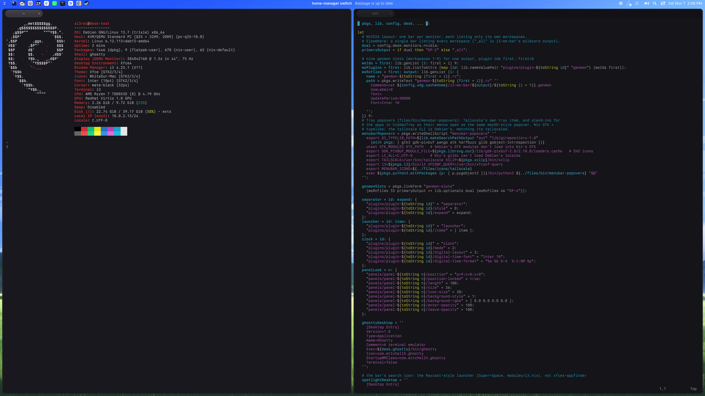
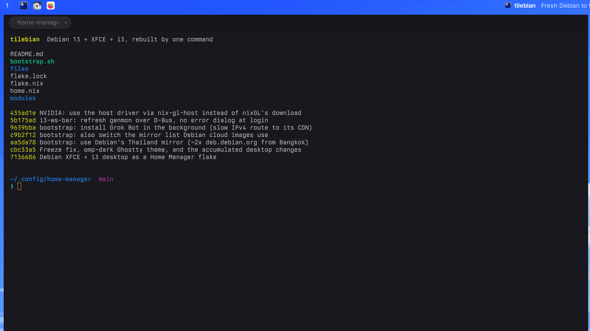
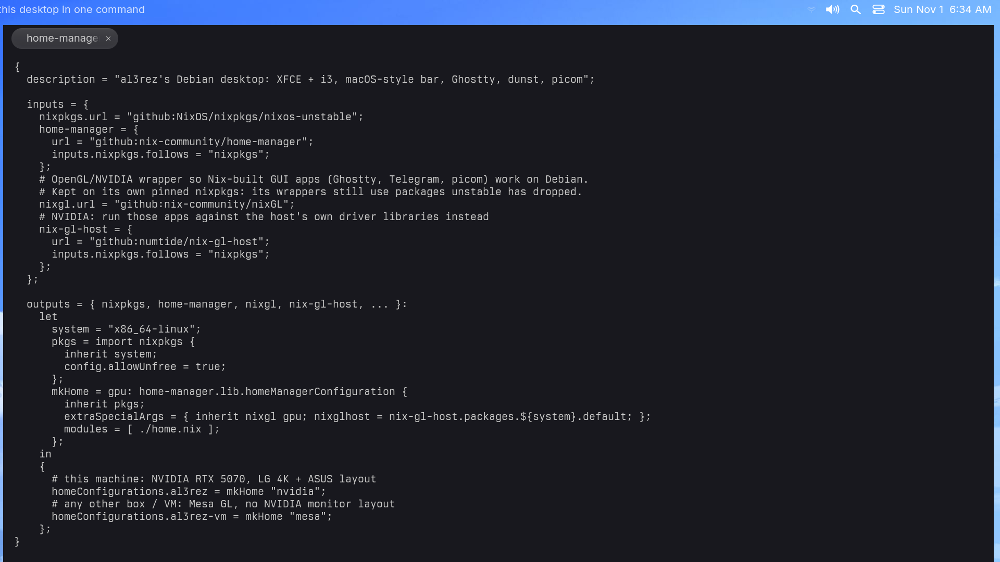

# devbox

Debian 13 + XFCE running i3 tiling, with a flat macOS-style menu bar, Ghostty and
notifications that slide into the bar. One command takes a fresh Debian install there,
built with a Nix Home Manager flake.



<sub>Historical 3840×2160 screenshot from the Debian 13 VM: Firefox (now removed), Telegram
and Ghostty tiled by i3, a notification in the bar. Below, the two top halves at 1:1 (no scaling).</sub>

| Left: workspace + pinned apps, Firefox | Right: notification in the bar, status icons, clock, Telegram |
|---|---|
|  |  |

Notifications are one line in the middle of the bar: no card, no background. picom slides them
down in and back up out (recorded in the VM at 60 fps, real speed, then 4× slower):


```sh
git clone https://github.com/al3rez/devbox ~/.config/home-manager
~/.config/home-manager/bootstrap.sh              # NVIDIA machine (LG 4K + ASUS layout)
~/.config/home-manager/bootstrap.sh al3rez-vm    # anything else (Mesa)
```

After the first run, apply changes with:

```sh
home-manager switch --flake ~/.config/home-manager#al3rez
```

## What it sets up

| Area | Where |
|---|---|
| i3 instead of xfwm4 in the XFCE session, 12px gaps, no window borders (picom dims unfocused windows instead) | `modules/session.nix`, `modules/i3.nix`, `files/i3/config` |
| Top bar: i3 workspace numbers, Ghostty + Grok Bot + ChatGPT + T3 Code + Slack + WhatsApp + Tern + Chrome + Steam left, tray / volume / search / control centre / clock right, ends aligned to i3 gaps. NVIDIA profile: one bar per monitor, each listing only its own workspaces (tray on the LG only) | `modules/panel.nix`, `files/gtk-3.0/gtk.css` |
| Workspaces belong to a monitor: 1–3 the LG, 4–6 the ASUS (`Super+N` jumps to that monitor; `Super+Ctrl+←/→` sends a window across). Each bar always shows its own three numbers, read from i3's config by `i3-ws-bar` (focused bright, other monitor's dimmer, rest dim, empty faint, urgent red; click to switch) | `files/i3/config`, `modules/i3.nix`, `files/bin/i3-ws-bar` |
| Pinned apps behave like the macOS Dock: a click focuses the app's window wherever it is (any workspace or monitor) and starts it if it has none; a double-click opens a new window. A notification from a pinned app puts a small white dot under its icon on every bar until you focus it | `files/bin/focus-or-launch`, `modules/panel.nix`, `files/bin/menubar-popovers`, `modules/notifications.nix` |
| Grok Bot (Cursor's apt repo), ChatGPT with Codex (OpenAI's official .deb, which adds its signed apt repo for updates) and T3 Code nightly (GitHub, digest-checked), installed in the background; pinned on the bar with matching macOS squircle icons (`files/bin/make-app-icon` fits any app's artwork into Grok Bot's squircle) | `files/bin/install-desktop-apps`, `files/icons/hicolor/`, `modules/panel.nix` |
| Slack from nixpkgs (GPU-wrapped like Ghostty/Telegram), pinned with the same squircle icon (`slack-mac`, made with `make-app-icon`); its colour tray icon is hidden. The switch rebuilds a stale `~/.local/share/icons/hicolor` icon cache so newly added icons show up | `home.nix`, `modules/packages.nix`, `modules/panel.nix`, `modules/theme.nix`, `files/icons/hicolor/` |
| WhatsApp as a web app, the way Omarchy does it: WhatsApp Web in a Chromium (nixpkgs) app window with its own window class, pinned with the macOS WhatsApp icon (Mac App Store artwork through `make-app-icon --square`) | `modules/panel.nix`, `home.nix`, `files/icons/hicolor/` |
| Tern (Stencil, invite only) packaged in Nix from its prebuilt tarball: `requireFile` pins the download by hash (add it once with `nix-store --add-fixed sha256 ~/Downloads/Tern-*.tar.gz`), the binary is patched for Nix and wrapped with the WebKitGTK/Vulkan/xcb libraries it loads at run time; pinned with its own macOS icon | `files/pkgs/tern.nix`, `home.nix`, `modules/panel.nix`, `files/icons/hicolor/` |
| Google Chrome from Google's `.deb` (its apt repo keeps it updated), pinned before Steam; Firefox is no longer installed by bootstrap or pinned. Chrome's icon uses `app.icns` from [Google's stable macOS download](https://dl.google.com/chrome/mac/universal/stable/GGRO/googlechrome.dmg), version 156.0.8078.80, fitted with the same `files/bin/make-app-icon` helper as the other apps and installed as a WhiteSur-Mac override. Chrome handles web links and is XFCE's preferred browser and Debian's `x-www-browser`. The user-local Slack entry handles `slack://` links from host browsers | `modules/packages.nix`, `files/bin/install-desktop-apps`, `modules/panel.nix`, `files/icons/WhiteSur-Mac/scalable/google-chrome.png` |
| Steam installed per-user from Flathub on activation, with Flatpak supplied by Nix and its session D-Bus services registered for Debian. Includes matching 64/32-bit NVIDIA runtimes without changing the host driver. Pinned after Chrome on both bars with official artwork from the installed Steam app, processed by `make-app-icon`, and click-to-focus behavior; also available as `steam`. Steam updates its client; update the Flatpak app/runtimes with `flatpak update --user` after switching Home Manager | `modules/packages.nix`, `modules/panel.nix`, `files/icons/WhiteSur-Mac/scalable/steam.png` |
| Minimal Raycast-style launcher on `Super+Space`: rofi with a frosted, rounded theme, a search field and one flat list of apps (the ones you open most first, then A–Z). Fuzzy search; Enter opens, Esc closes | `files/bin/launcher`, `files/rofi/launcher.rasi`, `modules/i3.nix`, `files/picom/picom.conf` |
| Clipboard History on `Super+Shift+V`, like Raycast's: a recorder (`clipboard-history` user service) keeps text, links, colors and images (1000 entries / 90 days, `~/.local/share/clipboard-history`, mode 0700; password-manager copies skipped). The window is the launcher's: it reads `launcher.rasi` for its size, colors and spacing, so both always match, with a preview of the selected entry on the right (the image, the text or the color). Enter pastes into the app you were in (Ctrl+Shift+V in terminals), Ctrl+Enter only copies, Shift+Delete removes the entry | `files/bin/clipboard-history`, `modules/i3.nix`, `files/i3/config`, `files/picom/picom.conf` |
| Region screenshot on `Ctrl+Shift+4` (like macOS ⌘⇧4): drag a region; it's saved to `~/Pictures/Screenshots/Screenshot <date> at <time>.png` and copied to the clipboard. Esc cancels | `modules/i3.nix`, `files/i3/config` |
| 144 DPI, Inter, WhiteSur-Mac icons, dark cursor (`mate-black`, 32 px, the same in every toolkit) | `modules/xfce.nix`, `modules/session.nix`, `modules/theme.nix` |
| picom: macOS-style 15px rounded window corners (10pt at 1.5x) and a window edge style on app windows and Clipboard History, chosen by `edge` in `modules/compositor.nix` (GLX only): `gloss`, a glass glint lit from the top-left (`gloss.frag`); `ring`, the macOS background-window edge, a 1pt dark outline plus a 1pt light inner rim (`edge-ring.frag`); `hairline`, the macOS key-window edge, a 1pt light rim brightest on top, darkening slightly on light windows (`edge-hairline.frag`). Every unfocused window dimmed, transparent bar, notification slide; frosted glass (blur) only behind the launcher, Clipboard History and menus. Menus (tray right-click, panel, apps) styled like macOS light menus: frosted, rounded, dark text, blue highlight. Tray shows only white glyphs: Electron apps' colour tray icons (ChatGPT, Slack) are hidden | `modules/compositor.nix`, `files/picom/picom.conf`, `files/picom/*.frag`, `files/gtk-3.0/gtk.css`, `modules/panel.nix` |
| dunst: one line in the centre of the bar, text only (no app icon), slides in/out | `modules/notifications.nix`, `files/dunst/dunstrc` |
| Ghostty: Berkeley Mono (TX-02), size 10, terminal padding, Superlogical tabs, terminfo. Panel icon: original rounded silver-frame [macOS artwork from Ghostty's repository](https://github.com/ghostty-org/ghostty/blob/main/macos/Assets.xcassets/AppIconImage.imageset/macOS-AppIcon-1024px.png), preserving the frame and matching Grok's visible bounds on a 512×512 canvas. Ghostty, Grok, and Steam have the same 26px visible height at the panel's 30px icon size (alpha ≥128); no extra squircle mask on Ghostty | `modules/ghostty.nix`, `files/ghostty/`, `files/icons/WhiteSur-Mac/scalable/com.mitchellh.ghostty.png` |
| Telegram Desktop with tray icon sized to match | `modules/packages.nix`, `files/icons/WhiteSur-Mac/` |
| Wallpaper (wallhaven gp7mq3, hash-pinned) | `home.nix` |
| Bash prompt | `modules/shell.nix`, `files/bash/prompt.sh` |
| Tailscale (official apt repo, daemon enabled, user is operator, Tailscale SSH on; run `tailscale up` once per machine). In the tray as a flat white dot mark like the other tray icons (faint when disconnected); clicking it opens a macOS-style popover (Wi-Fi, Telegram and Bluetooth open the same popover with their own menus): on/off switch, this device and its IP, every device with its IP (click copies), offline devices, exit node, admin console. The popovers also draw the bar's Wi-Fi, Bluetooth, Telegram and Tailscale icons, so they run as the `menubar-popovers` user service, which restarts itself if it ever exits. Clipman's tray icon is [Lucide](https://lucide.dev)'s clipboard (ISC licence) in white, scaled to the same 18px height and ~2.4px line weight as the other tray icons (`clipman.svg`) | `bootstrap.sh`, `files/apt/tailscale.gpg`, `files/bin/menubar-popovers`, `files/icons/tailscale/`, `modules/panel.nix` |
| Power: monitors off after 10 idle minutes via XFCE DPMS; `display-blanking` disables the separate X screensaver timer. System never sleeps (`caffeine` user service holds a logind sleep block) | `modules/power.nix` |
| LG 4K@240 + ASUS MB16FC at native 1920x1200@75, dual-only `MetaModes` in `/etc/X11/xorg.conf.d/20-nvidia-desk.conf`, soft DPMS (`HardDPMS false`). XFCE's default profile matches this layout; automatic profile selection and hotplug dialogs are disabled. `apply-desk-layout` uses cached `xrandr --current` and does nothing when geometry/primary are already correct. `monitor-layout-guard` handles RandR changes and checks cached X DPMS/idle state every 5 seconds for user return without a RandR event. Missing outputs retry with 10–300 second backoff; no modeset while asleep, idle, or an output is missing. Failed commands remain visible and a 30-second timeout kills the recovery process group. On the same 5-second tick it puts a menu bar back on its own monitor if i3 docked it on the other one (after a panel restart), going by the bar's own reserved-space property; it never probes the driver or restarts the panel. Correct cached geometry cannot prove a panel physically woke up. Logs: `journalctl --user -u monitor-layout-guard` | `files/xorg/20-nvidia-desk.conf`, `files/bin/apply-desk-layout`, `files/bin/monitor-layout-guard`, `modules/monitors.nix` |
| RGB lighting off: both DDR5 sticks (ENE) and the ASRock B850M board's lighting controller (RGB header and the three addressable headers), set to Off by OpenRGB on every login (`rgb-off` user service), since RAM lighting resets when power is cut. Needs OpenRGB's udev rules in `/etc/udev/rules.d` (`bootstrap.sh` installs them). The Logitech G304 is left alone | `modules/rgb.nix`, `bootstrap.sh` |

## Moving this machine onto the flake

The live desktop was set up by hand first; a few of those pieces would shadow or duplicate the Nix ones, so remove them before the first switch:

```sh
rm -f ~/.local/bin/ghostty ~/.local/bin/telegram                  # AppImage / tarball launchers
rm -f ~/.local/bin/i3-ws-bar                                      # now a Nix store script
rm -f ~/.local/share/applications/com.mitchellh.ghostty.desktop
rm -f ~/.config/autostart/picom.desktop                           # i3 starts picom now
rm -rf ~/.local/share/fonts/NerdFontsSymbolsOnly ~/.local/share/fonts/Inter  # Nix ships both
./bootstrap.sh
```

Home Manager moves any other existing file it takes over to `*.backup`.

Not in the repo: Berkeley Mono is a paid font, so `font-family = TX-02` only works once its
files are in `~/.local/share/fonts/BerkeleyMono-TX-02/`; without them Ghostty uses its default font.

The genmon slot files (`~/.config/xfce4/panel/genmon-*.rc`) are copied, not linked: the panel
writes plugin settings back on exit, so the switch stops the panel, replaces them, and starts it
again. Editing them by hand needs the same order (`xfce4-panel -q`, edit, `xfce4-panel &`).

## Tested

Fresh Debian 13 (trixie) VM, `task-xfce-desktop`, then `./bootstrap.sh al3rez-vm`: i3 session,
transparent bar, wallpaper, Ghostty tabs + prompt, Telegram tray icon, centred notification, picom
all come up on first login.

## If the screen ever stays black

Nothing should cause this any more, but to recover without powering off:

- `Ctrl+Alt+F3`, log in, then `sudo systemctl restart gdm` (restarts the graphical session)
- or from another machine: `ssh al3rez` over Tailscale, same command
- if a new X config is the cause: `sudo rm /etc/X11/xorg.conf.d/20-nvidia-desk.conf` first
